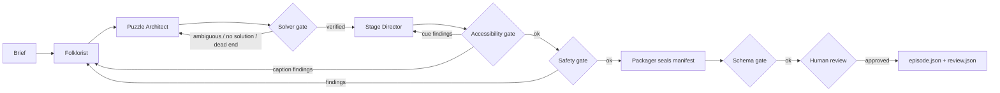

# Night Operator Design

- `src/pipeline.js` runs the steps in order; on a gate failure it rewinds to the earliest responsible role and re-runs everything after it.
- `src/gates/*` are pure functions returning `{ok, findings[{code,path,message,responsible}]}`.
- `src/lib/line13.js` imports LINE 13's solver and validator read-only (Node type stripping).
- `src/verify.js` re-checks the written file with LINE 13's own contract, solver, integrity, publication gate and web import.
- Model calls: `src/model/adapter.js` (DryRunClient fixtures, BedrockNovaClient with Nova allowlist).
