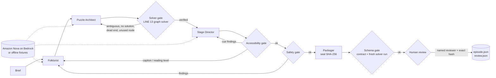

# Night Operator

**A Kiro Crew companion app that authors, solves, captions and packages episodes for LINE 13, gated so nothing ships unless LINE 13's own solver proves it has exactly one answer.**

Author: S Logesh. License: MIT. Built for the Kiroween 2026 "Best Kiro Crew App" bonus.

Companion to **LINE 13**, which you can play without a login at https://d38usbzsyul1ro.cloudfront.net (code: https://github.com/logesh4v/line-13). Night Operator is a build-time tool, so it has no hosted URL of its own: the playable result of its work is that game.

## Who it is for

Anyone who wants a model to write puzzle content but needs a guarantee that every puzzle is fair. Here that is LINE 13's author and its players; the pattern (model writes, a deterministic solver judges, a human signs off) applies to any generated content with checkable rules.

## Judge path: 60 seconds

```bash
git clone https://github.com/logesh4v/line-13.git
git clone https://github.com/logesh4v/night-operator.git
cd night-operator
npm test                                                  # offline, zero AWS calls
npm run dry-run                                           # runs the six roles; the first Puzzle Architect draft is rejected as ambiguous, the retry passes
node src/cli.js verify out/the-drowned-shift/episode.json # re-checks the sealed file with LINE 13's own validator and solver
```

Then read the captured run: [generated-episode-proof.md](docs/evidence/generated-episode-proof.md) and its [transcript](docs/evidence/the-drowned-shift.transcript.txt).

## How Kiro was used

- **Custom Kiro agents**: six role agents in [`.kiro/agents`](.kiro/agents). The pipeline reads each model role's system prompt from its agent file, so the agent you open in Kiro and the call the pipeline makes cannot drift apart.
- **Specs**: [`.kiro/specs/night-operator`](.kiro/specs/night-operator) (requirements, design, tasks).
- **Steering**: [`.kiro/steering`](.kiro/steering) (product rules, AWS-only and safety).
- **Hook**: [`.kiro/hooks/verify-and-test.json`](.kiro/hooks/verify-and-test.json).
- **Kiro Crew**: the app was built in Kiro Crew and is itself a Crew-style multi-agent pipeline.
- Evidence: [generated-episode-proof.md](docs/evidence/generated-episode-proof.md), and the LINE 13 repo's [Kiro evidence ledger](https://github.com/logesh4v/line-13/blob/main/docs/submission/kiro-evidence.md).

## The problem

LINE 13 is a 1930s telephone-exchange occult routing puzzle. Its promise is that every episode is solvable, unambiguous and cannot trap the player. Generative models are good at ghosts and bad at constraint satisfaction: asked for a puzzle, they hand back one with three valid answers, or none. Night Operator is the production line that makes model-written episodes safe to ship.

## What it does

A brief goes in; one sealed `episode.json` comes out that LINE 13 imports with no manual repair.



### Six role agents (real Kiro agents in `.kiro/agents`)

| Role | Job | Model? |
|---|---|---|
| Folklorist | callers, departure dates, opening lines, destinations, endings | Nova |
| Puzzle Architect | clues, constraints, intended routes | Nova |
| Solver | runs LINE 13's `computeProofReport`; rejects ambiguity | deterministic |
| Stage Director | haunt cues, captions, silent and reduced-motion alternatives | Nova |
| Accessibility Examiner | no-audio path, reduced motion, photosensitivity cap, reading grade | deterministic |
| Packager | strips private fields, embeds the proof, seals the manifest | deterministic |

The model roles read their system prompt from their own agent file, so the Kiro agent you can open in Kiro and the Nova call the pipeline makes cannot drift apart.

### Hard gates and the rework loop

1. **Solver**: status `verified`, exactly one solution, exhaustive recovery sweep, no unreachable node, intended order respects ordering clues.
2. **Accessibility**: every ring/voice/haptic cue has a silent alternative, every motion cue a reduced-motion alternative, flicker capped at intensity 2, subtitles and clues at grade 8 or lower.
3. **Safety**: conservative screen for gore, self-harm, minors in harm, PII and non-Amazon model names.
4. **Schema**: `episode.schema.json`, LINE 13's `validateEpisodeManifest`, cue/reference sanity, integrity hash, and a fresh solver run that must match the embedded proof.
5. **Human**: a named reviewer, the safety flag, and the exact manifest hash they reviewed. The pipeline never approves itself.

A failing gate does not patch anything. It returns the work to the role that owns the failing part, with the reason, and everything downstream re-runs. For ambiguity the Solver tells the Puzzle Architect which callers are still free ("caller-tobias could go to chapel / morgue / orchard") so the retry can be targeted. Three attempts per role, then it fails closed with no manifest.

### Why it is more than a prompt chain

- **Truth lives outside the model.** Solvability is decided by LINE 13's deterministic solver, imported read-only. Night Operator has no solver of its own to disagree with the game.
- **Independent acceptance.** `night-operator verify` re-checks the written file with LINE 13's own contract validator, solver, manifest-integrity check, publication gate and web import function. Agreement is evidence, not self-grading.
- **Deterministic and offline by default.** Fixture replay gives byte-identical episodes and zero AWS calls, so the whole pipeline is testable in CI.
- **AWS-only by construction.** The adapter refuses any model id that is not Amazon Nova before a request exists.

## Setup

Requires Node >= 22.18 (type stripping, used to import LINE 13's TypeScript read-only). No `npm install` needed. It needs a LINE 13 checkout, found by default in a folder named `line-13` next to this one.

```bash
git clone https://github.com/logesh4v/line-13.git
git clone https://github.com/logesh4v/night-operator.git && cd night-operator
# export LINE13_ROOT=/path/to/line-13      # only if line-13 is not next to this folder
npm test                                    # offline, zero AWS calls
npm run dry-run                             # publishes out/the-drowned-shift/ (reviewer recorded as S Logesh)
node src/cli.js verify out/the-drowned-shift/episode.json
```

Run without `--approve-as` to stop at the human gate, then finish it yourself:

```bash
node src/cli.js run --brief first-night --dry-run     # exit 3: awaiting-human-review, candidate.json written
node src/cli.js approve --dir out/the-drowned-shift --by "Your Name"
```

Other briefs: `short-shift` (2 callers, clean first pass), `stubborn` (never fixes the ambiguity; fails closed).

### Live Amazon Nova (implemented, not exercised in this repo's tests)

```bash
npm install @aws-sdk/client-bedrock-runtime        # only needed for live mode
export NIGHT_OPERATOR_ALLOW_LIVE=1                 # second opt-in; the flag alone is refused
node src/cli.js run --brief first-night --live --model amazon.nova-lite-v1:0 --region us-east-1
```

Uses the Bedrock Converse API with your standard AWS credential chain. The live client is tested end to end with a stub transport; real Nova output has not been run through it.

## Layout

```
.kiro/agents      six role agents          .kiro/steering   product + AWS-only/safety rules
.kiro/specs       requirements/design/tasks   .kiro/hooks   verify-on-save, test-on-save
contracts/        copy of LINE 13 episode schema + provenance
src/pipeline.js   steps, rewind loop       src/gates/       solver, accessibility, safety, schema, human
src/model/        Nova adapter + dry-run   src/verify.js    LINE 13 acceptance check
fixtures/         briefs + dry-run replies test/            offline test suite
docs/evidence/    generated-episode-proof.md (run `npm run prove` after committing)
```

## Limits

- Dry-run replies are authored fixtures; live Nova quality is untested here.
- Safety gate is lexical; the human gate carries semantic judgement.
- No audio: the Stage Director avoids the `sound` channel until LINE 13 ships Polly assets.
- LINE 13's publication gate rejects unreachable nodes, so episodes cannot carry decoy destinations.
